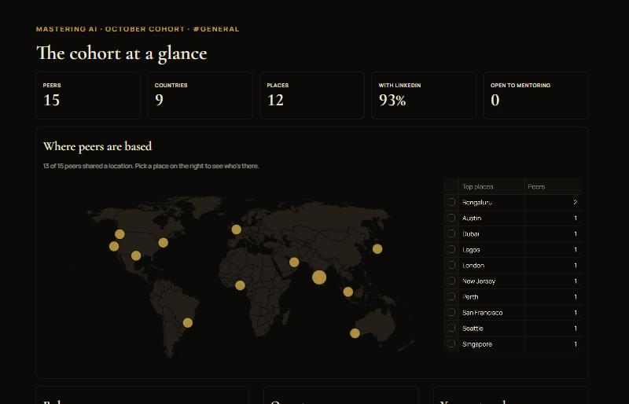
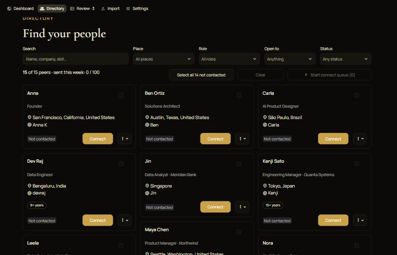

# Peer Atlas

**Turn a long Discord intro thread into a searchable directory, a world map of your cohort, and a calm way to connect on LinkedIn.**

Built as a vibe-coding project during the *Mastering AI* course (October cohort) with Python, Streamlit and Claude.

| Dashboard | Directory |
|---|---|
|  |  |

*Screenshots use fictional sample people.*

---

## What it does

1. **Import**: paste messages copied from Discord (or upload a moderator's export file).
2. **Extract**: Claude reads each intro and pulls out name, role, company, location, experience, skills and what people are open to. LinkedIn links are found with plain pattern matching, so they're never invented.
3. **Map**: locations like "BLR", "bay area" or "Morganville NJ" become points on a world map, offline.
4. **Review**: anything the extractor wasn't sure about is flagged, shown next to the original message, for you to fix or approve.
5. **Connect**: pick people (say, everyone in your city), and step through them one at a time. The app writes a personalised note, opens their LinkedIn profile, and tracks who you've contacted.

### Why doesn't it send LinkedIn requests automatically?
LinkedIn has no public API for sending invitations, and tools that click "Connect" for you break LinkedIn's terms and can get your account restricted. Peer Atlas does everything **except the final click**: you copy the note, open the profile, click **Connect → Add a note → paste → Send**, then mark it sent. A weekly counter keeps you under LinkedIn's invitation limits.

---

## Privacy and etiquette (please read)

People shared their details **with the community**, not with the internet.

- **Your data stays on your laptop.** Imported messages and peers live in `data/peer_atlas.db`, which Git ignores. Never commit it, and never upload the CSV export publicly.
- **Your API key stays on your laptop.** It lives in `.env`, which Git also ignores.
- **Collect messages by hand.** Copy and paste from Discord yourself. Don't use self-bots or scrape with your user token: Discord bans accounts for it.
- **Check with your server's moderators** before sharing a directory built from the channel.
- **Be a good connection.** Personal notes, a sensible pace, and no mass outreach.

---

## Quick start

You need **Python 3.11+** ([python.org](https://www.python.org/downloads/)) and **Git**.

### 1. Get the code
```bash
git clone https://github.com/RajivCloud/peer-atlas.git
cd peer-atlas
```

### 2. Create a virtual environment and install
**Windows (PowerShell)**
```powershell
python -m venv .venv
.venv\Scripts\Activate.ps1
pip install -r requirements.txt
```
If PowerShell says *"running scripts is disabled"*, use Command Prompt instead and run `.venv\Scripts\activate.bat`.

**macOS / Linux**
```bash
python3 -m venv .venv
source .venv/bin/activate
pip install -r requirements.txt
```

### 3. Add your Claude API key
Copy `.env.example` to `.env` and paste your key from [console.anthropic.com](https://console.anthropic.com) → API Keys:
```
ANTHROPIC_API_KEY=sk-ant-...
```
No key yet? You can still use the free **Rules only** extractor. It's weaker on roles and places.

### 4. Run it
```bash
streamlit run app.py
```
Your browser opens at http://localhost:8501.

---

## Try it with fake data first

`sample_data/sample_paste.txt` has 18 messages from fictional people. To explore without touching your own database, point the app at a separate demo file:

**Windows (PowerShell)**
```powershell
$env:PEER_ATLAS_DB = "data/demo.db"
python scripts/import_file.py sample_data/sample_paste.txt --engine rules
streamlit run app.py
```
**macOS / Linux**
```bash
export PEER_ATLAS_DB=data/demo.db
python scripts/import_file.py sample_data/sample_paste.txt --engine rules
streamlit run app.py
```
Open a new terminal (or unset `PEER_ATLAS_DB`) to go back to your real data.

---

## Using it with your channel

1. In Discord, open the channel and search `linkedin.com` to find intros quickly.
2. Select a stretch of messages, **including the "Name — date" lines**, and copy with Ctrl+C.
3. In Peer Atlas, open **Import**, paste, check the preview (new messages and estimated cost), and import.
4. Repeat for more chunks. Overlaps are fine: each message is only extracted once.
5. Open **Review** and approve or fix the flagged records.
6. Set your name and note template in **Settings**.
7. Use the **Directory** to find people and **Connect**.

**Cost:** with Claude Opus 5.5, about **$0.0035 per message** (82 messages ≈ $0.29). A 500-person channel is a few dollars, once. Add `CLAUDE_MODEL=claude-haiku-5-5` to `.env` for a much cheaper (less accurate) run.

---

## How it works

```
Discord text ──▶ ingest.py ──▶ extract.py / claude_extract.py ──▶ geo.py ──▶ db.py (SQLite) ──▶ Streamlit views
 (paste/JSON)    split messages,   rules or Claude (structured        city → lat/lon   one row per person,
                 pull LinkedIn     JSON output), merge each person's  (offline,         reviewed rows are
                 link previews     messages, flag doubtful records    34k cities)       never overwritten
```

```
peer-atlas/
├── app.py                 # entry point: page setup + navigation
├── views/                 # one file per screen
│   ├── dashboard.py       #   stats, world map, roles, outreach
│   ├── directory.py       #   search, filters, cards, connect queue
│   ├── review.py          #   fix and approve flagged records
│   ├── import_page.py     #   paste/upload, preview, CSV export
│   └── settings.py        #   note template, weekly limit
├── ui/                    # shared UI helpers and the connect pop-up
├── core/                  # all logic, no Streamlit imports (testable on its own)
│   ├── ingest.py          #   Discord text / export JSON → messages
│   ├── extract.py         #   rules extractor + merging + review flags
│   ├── claude_extract.py  #   Claude extractor (structured outputs, fallback to rules)
│   ├── geo.py             #   offline geocoding
│   ├── pipeline.py        #   import / preview / approve
│   ├── db.py              #   SQLite storage
│   ├── roles.py           #   job title → role family
│   └── templates.py       #   connection-note templates
├── scripts/               # command-line import and demo
├── tests/                 # pytest suite (free: never calls the API)
├── sample_data/           # fictional messages for trying the app
├── .streamlit/config.toml # black & gold light/dark theme
└── docs/                  # mockup and screenshots
```

### Run the tests
```bash
python -m pytest -q
```
The tests never call the Claude API, so they're free to run as often as you like.

---

## Ideas for your own version

Fork it and make it yours. Some ideas:

- A "timezone overlap" view for finding study partners
- Grouping by company or industry
- Reminders to follow up when a request has been pending for 2 weeks
- A shared, password-protected version for your whole cohort

## License

MIT. See [LICENSE](LICENSE).
